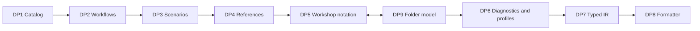

# Axiomatic Design Analysis of Event Modeling HCL v0.4.0

## Purpose and Scope

This document analyzes the Event Modeling HCL language with Axiomatic Design.
Axiomatic Design is a method that maps the outcomes a design must give to the
parts that give them. The method then tests whether each part controls its own
outcome without side effects on other outcomes.

The analysis covers the normative specification
[`eventmodeling.hclspec.md`](eventmodeling.hclspec.md) v0.4.0 and the accepted
RFCs [0001](rfcs/0001-field-shorthand-and-screen-fields.md) and
[0002](rfcs/0002-multi-file-models.md). [RFC 0003](rfcs/0003-hotspot-resolution.md)
is a proposal. It contains its own analysis of the hotspot branch, and this
document does not repeat it.

v0.5.0 adopted [RFC 0004](rfcs/0004-uncoupled-authoring-controls.md). It acts
on findings F1, F2, F3, and F5 below. This document still describes v0.4.0; the
RFC records the v0.5.0 design and its matrices.

The subject is the language. The document names the responsibilities that the
language gives to the validator, the typed IR, and the formatter. It does not
design code, packages, or classes.

The method comes from Kim, Suh, and Kim, *Design of Software Systems Based on
Axiomatic Design* (1991). This document uses an architecture form of the
method. In the paper, a design parameter is often input data. Here, a design
parameter is a language rule or a mechanism of the language.

## Evidence

Each important claim has one of four labels:

| Label | Meaning |
| --- | --- |
| [Spec] | The specification, an accepted RFC, an ADR, or the changelog states it. |
| [Code] | The Go implementation source states it. The specification does not. |
| [Observed] | A probe with the `emhcl` CLI showed it. Appendix A lists each probe. |
| [Inference] | The analysis concludes it. No probe tested it. |

The probes used the `emhcl` binary in the implementation repository at commit
`2aa8f92` (2026-10-09). A probe shows the behavior of that build. It does not
prove the behavior of every conforming implementation.

## Terms

The analysis uses these terms:

- Need (N): an outcome that a person wants from the language.
- Functional requirement (FR): one outcome that the design must give, with a
  test that shows it.
- Design parameter (DP): the language rule or mechanism that gives an FR.
- Constraint (C): a limit on every acceptable design.
- Design matrix: a table with FRs as rows and DPs as columns.
- Board order: the left-to-right order of workflows on an Event Modeling board.

A cell in a design matrix tells whether a change to the DP in that column
changes the FR in that row. `X` means a material influence. `0` means no
material influence, and the text gives the reason. `?` means that the influence
is unknown. A matrix is a model of influence. It is not a call graph.

A design matrix has one of four classes:

- Uncoupled: only the diagonal has `X`. Each DP controls one FR.
- Decoupled: the matrix is triangular. You must decide the DPs in a fixed order.
- Coupled: no order makes the matrix triangular. A change to one DP forces you
  to revisit another DP, and then the first again.
- Unresolved: `?` cells prevent a defensible class.

## Needs

The needs come from the specification, ADR 0002, and the motivation of RFC
0002 [Spec].

| ID | Need |
| --- | --- |
| N1 | Domain experts and developers write an event model as plain text that they can review in version control. |
| N2 | Authors find modeling mistakes before the model reaches other people or tools. |
| N3 | Teams keep workshop information: who acts, who owns what, which questions are open, and the order of the story. |
| N4 | Each team decides how strictly the tool treats modeling judgment. |
| N5 | Downstream tools, for example diagrams, export, and code generators, read one stable model and not raw text. |
| N6 | Two authors get the same text for the same model. |
| N7 | A large team splits one model into many files. |

## Constraints

The constraints come from the specification and the ADRs [Spec].

| ID | Constraint |
| --- | --- |
| C1 | The source syntax is HCL (ADR 0002). |
| C2 | The upstream Event Modeling Specification is the domain reference. |
| C3 | Since v0.2.0, each release is additive. Every valid model stays valid and keeps its meaning. |
| C4 | The source is the only authority. The language has no `include`, no `import`, no modules, no variables, and no computed values. |
| C5 | Event Modeling concepts are block kinds. Labels are lower snake case. |

C3 is the reason why most alternatives in this document are for a future
breaking version only.

## Level 0

FR0: Let people write an event model as validated text that tools can use.

DP0: A native HCL language with three companions. The validator finds
problems. The typed IR gives tools a normalized model. The formatter gives one
layout.

## Level 1

### Requirements and Design Parameters

The acceptance criteria come from the specification [Spec], except where the
table says "proposed".

| FR | Outcome and acceptance criterion | Need | DP | How the DP gives the FR |
| --- | --- | --- | --- | --- |
| FR1 | Declare each domain contract once, with one owner. Each event, aggregate, and field type has exactly one declaration inside one bounded context. | N1, N2 | DP1: bounded-context catalog | `bounded_context` contains `event`, `aggregate`, and `field_type`. The context name is part of the qualified ID. |
| FR2 | Describe behavior as one of the four Event Modeling patterns, with one direction of flow. Each workflow has one pattern. Each edge has one valid spelling. A reverse spelling fails. | N1, N2 | DP2: pattern-typed workflow blocks with canonical edges | `state_change`, `state_view`, `automation`, and `translation` blocks. A table fixes which block holds `from` and which block holds `to`. |
| FR3 | Specify expected behavior as examples beside the behavior. Each scenario step has one typed target that fits the pattern of its workflow. | N1, N2 | DP3: workflow-local scenarios | `scenario` blocks inside the workflow. A table fixes the targets and the counts of `given`, `when`, and `then` for each pattern. |
| FR4 | Connect elements by names that a machine resolves. Each reference resolves to exactly one element of the expected kind, or the model fails. | N2 | DP4: typed traversal references | Unquoted HCL traversals in three scopes: catalog, workflow-local, and workflow-qualified. Computed references are invalid. |
| FR5 | Keep workshop information without a change to behavior. Actors, owners, chapters, hotspots, and status add no edges and no scenarios. The board order is predictable. | N3 | DP5: workshop notation | `actor`, `team`, `system`, `owner`, `chapter`, `hotspot`, and workflow `status`. |
| FR9 | Let a model live in many files with the same meaning. A split of a one-file model into a folder gives the same validation result, apart from `EM407` for workflows that no chapter lists (RFC 0002, section 3). | N7 | DP9: folder model | A folder is one model. It is the union of the top-level blocks of its direct `.em.hcl` members. IDs stay global. Chapters set the board order. |
| FR6 | Report each problem at its source with a stable code. Let the team choose the strictness for judgment. | N2, N4 | DP6: diagnostic codes and profiles | Code families `EM0xx` to `EM4xx`. Profiles `workshop`, `valid`, and `strict` change only the severity of judgment codes. |
| FR7 | Give tools one normalized model. Tools get the IR only from a model without errors. The IR has effective titles, one source-to-target edge list, and ordered workflows. | N5 | DP7: validation-gated typed IR | The loader validates first. It builds the IR only when validation reports no error. |
| FR8 | Keep the source in one layout. Two runs of `fmt` give the same text. `fmt` does not change the meaning. | N6 | DP8: per-file canonical formatter | `fmt` sets whitespace and attribute order. It keeps block order, scenario order, and traversal text. |

The FR numbers follow the order of the matrix below. FR9 sits before FR6
because the validator, the IR, and the formatter all depend on the folder rules.

### Design Matrix

| | DP1 | DP2 | DP3 | DP4 | DP5 | DP9 | DP6 | DP7 | DP8 |
| --- | --- | --- | --- | --- | --- | --- | --- | --- | --- |
| FR1 | X | 0 | 0 | 0 | 0 | 0 | 0 | 0 | 0 |
| FR2 | X | X | 0 | 0 | 0 | 0 | 0 | 0 | 0 |
| FR3 | X | X | X | 0 | 0 | 0 | 0 | 0 | 0 |
| FR4 | X | X | 0 | X | 0 | 0 | 0 | 0 | 0 |
| FR5 | 0 | X | 0 | X | X | X | 0 | 0 | 0 |
| FR9 | X | X | 0 | X | X | X | 0 | 0 | 0 |
| FR6 | X | X | X | X | X | X | X | 0 | 0 |
| FR7 | X | X | X | X | X | X | X | X | 0 |
| FR8 | X | X | X | 0 | X | 0 | 0 | 0 | X |

The cell FR5/DP9 is the only `X` above the diagonal. The next section gives
its reason.

### Reasons for the Important Cells

These cells carry the main argument:

- FR2/DP1 is `X`. The `external` flag of a context decides whether a workflow
  must be an `automation` or a `translation` [Spec]. A change of the flag turned
  a valid automation into error `EM012` [Observed, probe P2].
- FR4/DP5 is `0`. The reference form `<kind>.<id>` is generic. A new workshop
  kind adds a new kind name, but it does not change how references resolve
  [Inference].
- FR4/DP9 is `0`. RFC 0002 kept one global ID space so that every v0.3.0
  reference form stays valid. It rejected modules and name spaces for this
  reason [Spec].
- FR5/DP9 is `X`. In a model with two or more files, chapters set the board
  order and `EM006` does not apply. In a one-file model, source order sets the
  board order and `EM006` applies [Spec]. The same chapter content failed with
  `EM006` in one file and passed in a folder [Observed, probe P5].
- FR9/DP5 is `X`. The folder model uses chapters to fix the board order.
  Without a chapter, the order of workflows follows the file names [Spec,
  Observed, probe P4].
- FR7/DP6 is `X`. The implementation builds the IR only when the chosen profile
  reports no error. The `strict` profile turns an open hotspot into an error
  [Code]. The specification says only "a clean model" [Spec]. Thus, in the
  specification alone, this cell is `?`.
- FR7/DP8 is `0`. A formatted copy and an unformatted copy of
  `examples/appointment-weather.em.hcl` gave the same export [Observed, probe
  P6].
- FR8/DP9 is `0`. `fmt` formats one file and never moves blocks between files
  [Spec].

### Class and Order

The level 1 matrix is decoupled, apart from one coupled block. The coupled
block is FR5 and FR9 with DP5 and DP9.

The design order is DP1, DP2, DP3, DP4, then DP5 and DP9 together, then DP6,
DP7, and DP8. A change to an earlier DP can force a change to a later DP. A
change to a later DP must not change an earlier FR.

The language history follows this order. RFC 0001 changed the field rules in
DP1 and DP2, and the formatter (DP8) and the validator codes (DP6) followed
[Spec]. RFC 0003 proposes a change to hotspots in DP5. It lists the effects on
`EM406` (DP6), the IR (DP7), and the attribute order of `fmt` (DP8) [Spec]. Each
change moves down the matrix. RFC 0002 is the exception. It added DP9, and DP9
changed the meaning of chapters in DP5. That change moves up the matrix.

The arrows show the design order. The double arrow shows the coupled block.

## Level 2

Each section below takes one level 1 FR and its DP. It derives child FRs inside
that DP and tests their matrix. A branch stops when its owner, its contract,
its failure behavior, and its acceptance test are clear.

### FR1: Domain Catalog and Fields

| FR | Outcome | DP |
| --- | --- | --- |
| FR1.1 | Each contract has exactly one owner. | DP1.1: containment in `bounded_context` and the qualified ID `<kind>.<context>.<id>` |
| FR1.2 | Each field has exactly one effective type. | DP1.2: an explicit `type`, or inference from the field name |
| FR1.3 | Contracts from outside the modeled system are visible as such. | DP1.3: `external = true` on the context |

| | DP1.1 | DP1.2 | DP1.3 |
| --- | --- | --- | --- |
| FR1.1 | X | 0 | 0 |
| FR1.2 | X | X | 0 |
| FR1.3 | 0 | 0 | X |

This matrix is decoupled. You declare the catalog first, and then the field
types resolve against it.

The FR1.2/DP1.1 cell needs attention. A typeless field inside a context
resolves in that context. A typeless field on a workflow element resolves by a
unique name across the whole model [Spec]. Thus, a new `field_type` in an
unrelated context can break a field in a workflow that never names that
context. In probe P1, a new context `billing` with a `field_type
"appointment_id"` gave `EM009` on the screen and the command of
`schedule_appointment` [Observed]. The event field in the context `appointments`
stayed valid. The `fields` list entry also stayed valid, because it uses a
qualified traversal [Observed].

The failure is loud. The model fails, and no field silently gets a wrong type.
The residual risk is effort, not wrong meaning. In a folder model the new
context can be in another file, so the author of the change does not see the
broken field [Inference].

FR1.3 also controls FR2.3 in another branch. The section on cross-branch
influences describes this.

### FR2: Workflows and Flow

| FR | Outcome | DP |
| --- | --- | --- |
| FR2.1 | Each workflow has exactly one pattern. | DP2.1: the block kind keyword |
| FR2.2 | Each edge has one spelling and runs from source to target. | DP2.2: the table of canonical edges. Reverse spellings are errors. |
| FR2.3 | The pattern agrees with the source of the consumed events. | DP2.3: the translation rule. A translation consumes at least one external event, and an automation consumes none (`EM011`, `EM012`). |

| | DP2.1 | DP2.2 | DP2.3 |
| --- | --- | --- | --- |
| FR2.1 | X | 0 | 0 |
| FR2.2 | X | X | 0 |
| FR2.3 | X | X | X |

This matrix is decoupled. The pattern decides the allowed edges. The edges
decide which events a workflow consumes. The translation rule then compares the
pattern with those events.

The choice between `automation` and `translation` is stated twice. The block
keyword states it, and the `external` flag of the source context also implies
it [Inference]. DP2.3 makes sure that the two statements agree. This is a
redundant control. A redundant control gives one more place for a mistake. It
also makes the intent of the author visible on the board. No evidence measures
which effect is larger.

### FR3: Scenarios

| FR | Outcome | DP |
| --- | --- | --- |
| FR3.1 | Each step names exactly one typed target. | DP3.1: step blocks with one target attribute. `error` is a literal string. |
| FR3.2 | The steps fit the pattern. | DP3.2: the table of targets and counts for each pattern |
| FR3.3 | The steps keep the order of the author. | DP3.3: source order. Steps are never reordered. |

| | DP3.1 | DP3.2 | DP3.3 |
| --- | --- | --- | --- |
| FR3.1 | X | 0 | 0 |
| FR3.2 | X | X | 0 |
| FR3.3 | 0 | 0 | X |

This matrix is decoupled. FR3.2 also depends on DP2.1 in another branch. A
change of the workflow kind changes which scenarios are valid [Spec]. This
influence follows the design order, so it adds no coupling.

### FR4: References and Identity

| FR | Outcome | DP |
| --- | --- | --- |
| FR4.1 | Each identity is unique in its space. | DP4.1: ID spaces. Each catalog kind has one space, all workflow kinds share one space, and element IDs are local to their workflow. |
| FR4.2 | Each reference resolves to one element of the expected kind. | DP4.2: unquoted traversals in three scopes, with kind rules (`EM101`, `EM102`) |
| FR4.3 | People see readable names without a change to identity. | DP4.3: an optional `title`. Without it, the IR derives a title from the label. |

| | DP4.1 | DP4.2 | DP4.3 |
| --- | --- | --- | --- |
| FR4.1 | X | 0 | 0 |
| FR4.2 | X | X | 0 |
| FR4.3 | X | 0 | X |

This matrix is decoupled. The label is both the identity and the default title.
Thus, the order is: choose the label first, and then add a `title` if the
derived title is not good. If an author renames a label only to get a better
title, every reference to it breaks [Inference]. The explicit `title` removes
this need, because it changes FR4.3 and nothing else. The formatter never
writes a derived title back to the source [Spec].

### FR5 and FR9: Workshop Notation and the Folder Model

FR5 and FR9 form the coupled block of level 1. This section decomposes both
together, because they share one child outcome: the board order.

| FR | Outcome | DP |
| --- | --- | --- |
| FR5.1 | Record who acts and who owns. | DP5.1: `actor`, `team`, `system`, and `owner` references |
| FR5.2 | Record open questions and their state. | DP5.2: `hotspot` with `question`, `on`, and `status`. An omitted status means `open`. |
| FR5.3 | Record the progress of each workflow. | DP5.3: the workflow `status` values |
| FR5.4 | Group workflows into named parts of the story. | DP5.4: `chapter` with a `workflows` list |
| FR5.5 | Give the board one predictable order. | DP5.5: the order rule. In one file, source order. In two or more files, chapter order, then unchaptered workflows by file name. |
| FR9.1 | Find the member files without an extra list. | DP9.1: direct `.em.hcl` members, without dot files, sorted by byte order |
| FR9.2 | Keep the meaning of references across files. | DP9.2: the union of top-level blocks, global IDs, and no block across files |

FR5.1, FR5.2, and FR5.3 are uncoupled from the rest. Each of them has its own
attributes, and none of them sets edges, scenarios, or order [Spec]. The
hotspot branch has its own matrix in RFC 0003, section 6.

The matrix for the remaining children depends on the number of member files.
The analysis therefore gives two matrices.

One-file model, or a folder with one member file:

| | DP5.5 | DP5.4 | DP9.1 |
| --- | --- | --- | --- |
| FR5.5 | X | 0 | 0 |
| FR5.4 | X | X | 0 |
| FR9.1 | 0 | 0 | X |

Source order sets the board. A chapter must list a contiguous run of workflows
in source order (`EM006`). Thus, the order comes first, and the chapters must
follow it. This matrix is decoupled.

Folder model with two or more member files:

| | DP5.4 | DP9.1 | DP5.5 |
| --- | --- | --- | --- |
| FR5.4 | X | 0 | 0 |
| FR9.1 | 0 | X | 0 |
| FR5.5 | X | X | X |

Chapters set the order for every workflow that they list. File names set the
order of the rest. Thus, the chapters come first, and the order follows them.
This matrix is also decoupled.

Each mode is decoupled, but the two modes need opposite design orders. The
number of member files selects the mode. The number of files is a storage
decision, and it is not a modeling decision. Three probes show the effect:

| Probe | Change | Result |
| --- | --- | --- |
| P3 | Add a file that holds only one `actor` to a folder with one model file. | `EM407` appears on a workflow in the other file. Under `--profile strict`, the model fails. [Observed] |
| P4 | Rename two workflow files and change nothing else. | The export order of the two workflows changes. [Observed] |
| P5 | Move a chapter that lists workflows out of source order into its own file. | `EM006` disappears and the model is valid. [Observed] |

RFC 0002 knows P4. It says that a rename of a file can move only unchaptered
workflows, and that `EM407` exists for this reason [Spec]. P3 and P5 are not
named in the RFC. P5 is also an exception to the migration sentence in RFC
0002, section 3. That sentence says that a split gives the same result as
before. It is true for models that are valid before the split. It is not true
for a model with an `EM006` error [Observed, Inference].

The coupling is contained. It affects only chapters and board order. It does
not affect references, edges, scenarios, or the IR shape [Spec]. Workflows in a
chapter keep their order across renames and splits [Spec, probe P4].

### FR6: Diagnostics and Profiles

| FR | Outcome | DP |
| --- | --- | --- |
| FR6.1 | Each objective rule violation stops the model. It names `file:line:column` and a stable code. | DP6.1: code families `EM0xx` structure, `EM1xx` references, `EM2xx` flow, `EM3xx` scenarios. They are always errors. |
| FR6.2 | Judgment signals appear at the strictness that the team chooses. | DP6.2: the profile map for `EM4xx` codes. `strict` raises only `EM404`, `EM406`, and `EM407`. The four visual smells never block. |

| | DP6.1 | DP6.2 |
| --- | --- | --- |
| FR6.1 | X | 0 |
| FR6.2 | 0 | X |

This matrix is uncoupled. The zero in FR6.1/DP6.2 has evidence. The profile
table in the implementation lists only codes `EM401` to `EM407` [Code,
`internal/validator/diagnostics.go`]. Probe P7 showed `EM406` as `Info`,
`Warning`, and `Error` under the three profiles [Observed].

The specification names only some codes. It names `EM001`, `EM002`, `EM006`,
`EM013`, `EM014`, `EM404`, `EM406`, and `EM407`, and the code families [Spec].
The implementation defines 28 codes, from `EM000` to `EM407` [Code]. RFC 0001
refers to `EM009`, `EM101`, and `EM102`. The specification does not list
them [Spec]. The specification names the bed, left-chair, right-chair, and
shelf smells, but it does not define them [Spec]. Thus, FR6.1 promises stable
codes, but the specification does not own the list of codes. The
implementation owns it.

### FR7: Typed IR

| FR | Outcome | DP |
| --- | --- | --- |
| FR7.1 | Tools get a model only when it has no errors. | DP7.1: the validation gate |
| FR7.2 | Tools get one normalized shape. | DP7.2: the IR shape. It has effective titles, semantic and presentation fields, ordered workflows and scenarios, and one `Edges` list from source to target. |

| | DP6.1 | DP6.2 | DP7.1 | DP7.2 |
| --- | --- | --- | --- | --- |
| FR7.1 | X | X | X | 0 |
| FR7.2 | 0 | 0 | 0 | X |

This matrix is decoupled. The FR7.1/DP6.2 cell is the important one. The
implementation calls the gate with the chosen profile [Code,
`internal/app/app.go` and `internal/serve/serve.go`]. `diagram` and `export`
use the `valid` profile. `serve --profile strict` uses `strict`. Under `strict`,
an open hotspot or a workflow outside every chapter is an error, and the
`serve` page then shows no diagram [Code, Inference]. Probe P7 showed that
`diagram` under the default profile rendered a model with an open hotspot
[Observed].

Thus, a policy for judgment also decides whether a tool gets a model. The
specification does not say which profile the gate uses. It says only "a clean
model". For the specification alone, FR7.1/DP6.2 is `?`.

### FR8: Formatter

| FR | Outcome | DP |
| --- | --- | --- |
| FR8.1 | Two runs give the same text. | DP8.1: a fixed attribute order and whitespace rules |
| FR8.2 | Formatting does not change the meaning. | DP8.2: keep block order, scenario order, and traversal text. Never write derived titles. Never expand shorthand. |

| | DP8.1 | DP8.2 |
| --- | --- | --- |
| FR8.1 | X | 0 |
| FR8.2 | 0 | X |

This matrix is uncoupled. Probe P6 showed both outcomes on
`examples/appointment-weather.em.hcl`. The second `fmt` run made no change,
and the export before and after `fmt` was identical [Observed].

Each new attribute in DP1, DP2, DP3, or DP5 needs a place in the attribute
order of DP8.1. RFC 0001 and RFC 0003 both state that place [Spec]. This is the
lower-triangle influence from the level 1 matrix.

## Cross-Branch Influences

Local matrices do not prove independence for the whole language. These shared
items connect branches:

| Shared item | Owner | Branches that it affects | Effect | Evidence |
| --- | --- | --- | --- | --- |
| Global name space of `field_type` for typeless workflow fields | DP1.2 | FR1.2 across all workflows and all files | A new field type in one context can give `EM009` in an unrelated workflow. | [Observed, P1] |
| `external` flag of a context | DP1.3 | FR2.3 | A change of the flag changes which workflow kind is valid. | [Observed, P2] |
| Workflow kind | DP2.1 | FR2.2, FR3.2 | The kind changes which edges and which scenarios are valid. | [Spec] |
| Global ID spaces | DP4.1 | FR4, FR9.2 | The same ID in two files is `EM002`. | [Spec] |
| Number of member files | DP9.1 | FR5.4, FR5.5, FR6 | Two or more files switch the chapter rules and add `EM407`. | [Observed, P3, P5] |
| File names | DP9.1 | FR5.5 | File names order the unchaptered workflows. | [Observed, P4] |
| Profile | DP6.2 | FR6.2, FR7.1 | The profile decides the severity, and in the implementation also the IR gate. | [Code, Observed, P7] |

## Composition

The validator composes the branches as a chain. This document uses the three
junction types of the paper. A summation (S) combines results that are
independent. A control junction (C) enforces an order. A feedback junction (F)
shows a coupled loop.

| Step | Junction | Reason |
| --- | --- | --- |
| Parse each member file | S | Each file must parse alone [Spec]. The result for one file does not depend on another file. |
| Join the files into one model | C | The union needs every file. The order needs the sorted file names. |
| Resolve references | C | References need the full union of IDs. |
| Apply structure, flow, and scenario rules | S | Each family tests its own rules on the resolved model. |
| Apply judgment rules and map severity by profile | C | The profile maps the severity after the rules run. |
| Build the IR | C | The build runs only when no error remains. |
| Format a file | S | `fmt` is separate from validation and works on one file. |
| Chapter rules and folder rules | F | This is a design-time loop, not a runtime loop. A change to the chapter rules forces a review of the folder rules, and the reverse. |

The runtime has no feedback loop. The only F junction is in the design of the
language.

## Findings

Each finding states the affected FRs, the reason, the options, and the residual
risk. The options for a future version must respect C3, unless that version is
a breaking version.

### F1: Board Order Depends on the Number of Files

Affected FRs are FR5.4, FR5.5, FR9, and FR6. The reason is that the number of
member files selects one of two order rules, and each rule needs the opposite
design order. Probes P3, P4, and P5 show the effects.

| Option | Effect |
| --- | --- |
| A. Keep the v0.4.0 rule. | No change. `EM407` reports the risk in folder models. P3 and P5 stay. |
| B. Use the folder rule for every model with at least one chapter. | Chapters always set the order. The role of a chapter no longer depends on the number of files. A one-file model with a chapter and unchaptered workflows changes its board order. This breaks C3. |
| C. Use the one-file rule for every model. | `EM006` applies in folders too. Folder authors must keep the chapter list in file and source order. This removes the main reason for RFC 0002 chapters. |
| D. Keep the rule, and state its effects in the specification. | Name P3 and P5 in the section "Multi-file Models". Limit the RFC 0002 migration sentence to models that are valid before the split. |

Option D is the recommendation for v0.4.x, because it respects C3. Option B is
the candidate for a future breaking version. It is the only option that makes
the role of a chapter constant. Both recommendations are provisional. No
evidence measures how often authors meet P3 or P5.

### F2: The IR Gate Depends on the Judgment Profile

Affected FRs are FR6.2 and FR7.1. The reason is that the implementation builds
the IR only when the chosen profile reports no error, and the specification
does not state this.

| Option | Effect |
| --- | --- |
| A. The gate uses the active profile. This is the current code. | `serve --profile strict` hides the diagram while a hotspot is open. The profile controls both FR6.2 and FR7.1. |
| B. The gate uses only objective errors, `EM0xx` to `EM3xx`. | The IR exists for every model that passes the objective rules. A tool can still refuse output under `strict` by its own rule. FR7.1 depends only on DP6.1. |

The recommendation is that the specification states one of the two rules.
Option B removes the FR7.1/DP6.2 influence. Option A keeps `strict` as one gate
for all tools. The choice belongs to the language owners.

### F3: Typeless Workflow Fields Depend on the Whole Catalog

The affected FR is FR1.2. The reason is that a typeless field on a workflow
element resolves by a unique name across all contexts. Probe P1 shows the
effect. The failure is loud, so the risk is rework and not wrong meaning.

| Option | Effect |
| --- | --- |
| A. Keep the rule. | `EM009` reports every ambiguous field. |
| B. Use the qualified `fields` list, or an explicit `type`, on workflow elements in models with many contexts. | A guide states this practice. No language change is needed. Probe P1 showed that the `fields` entry stayed valid. |
| C. Let an internal context win over an external context. | RFC 0001 lists this as an open question. It removes only the ambiguity between internal and external contexts. Two internal contexts still give `EM009`. |

Option B is the recommendation, because it needs no change to the language.

### F4: The Specification Does Not Own the Diagnostic Codes

Affected FRs are FR6.1 and FR6.2. FR6.1 promises stable codes. The full list of
28 codes lives only in the implementation [Code]. The four visual smells have
names but no definitions in the specification [Spec].

The recommendation is a table in the specification with each code, its family,
its summary, and its severity in each profile. The table must also define the
bed, left-chair, right-chair, and shelf smells. A second implementation then has
a normative source for FR6.

### F5: The Pattern Keyword and the External Flag State One Fact Twice

The affected FR is FR2.3. The keyword `automation` or `translation` and the
`external` flag both state whether a workflow consumes an outside event. DP2.3
makes sure that they agree. This is not a coupling, because the order is clear:
first the catalog, then the workflow. It is a redundancy.

No action is recommended. A change breaks C3 and C5. The keyword also
makes the pattern visible to workshop readers. This finding is recorded so that
a future version can compare the options with evidence.

## Information Axiom

The second axiom selects, among designs that pass the first axiom, the design
with the highest probability of success. The measure is the information
content `I = -log2(p)`. In this formula, `p` is the probability that the design
meets all its FRs in their acceptance ranges.

No measured probabilities exist for this language. This document therefore
gives no information-content numbers. The recommendations in the findings are
provisional. A low number of rules or a short syntax is not a low information
content.

These measurements can separate the options:

| ID | Measurement | Options it separates |
| --- | --- | --- |
| M1 | Give authors a one-file model with chapters. Ask them to split it into a folder. Count how often validity and board order stay the same. | F1 options A, B, and D |
| M2 | In real models with three or more contexts, count the typeless workflow fields. Add one field type that repeats an existing name. Count the new `EM009` errors. | F3 options A and B |
| M3 | Ask readers to name the pattern of a workflow from the board, with and without the pattern keyword. | F5 |

Measure the joint success of all FRs in each case. Do not add the separate
values unless the outcomes are independent. A shared cause, for example one
wrong file split, can break several outcomes together.

## Validation Scenarios

Each change scenario changes one DP and tests the predicted FRs.

| Change | Predicted effect | Result |
| --- | --- | --- |
| Add a `field_type` with an existing name in a second context (DP1.1). | FR1.2 fails for typeless workflow fields only. | Confirmed by P1. |
| Set `external = true` on a context that an automation consumes (DP1.3). | FR2.3 fails with `EM012`. | Confirmed by P2. |
| Add a file with only an actor (DP9.1). | FR1 to FR4 unchanged. `EM407` appears. | Confirmed by P3. |
| Rename workflow files (DP9.1). | Only unchaptered workflows change order. | Confirmed by P4 for unchaptered workflows. |
| Move a chapter into its own file (DP9.1). | `EM006` no longer applies. | Confirmed by P5. |
| Run `fmt` twice (DP8). | No second change. Export unchanged. | Confirmed by P6. |
| Change the profile (DP6.2). | Only `EM4xx` severities change. | Confirmed for `EM406` by P7. |
| Use `strict` with an open hotspot in `serve` (DP6.2). | No diagram. | Read in code. Not run. |
| Rename a label that other blocks reference (DP4.1). | `EM102` at each reference. | Predicted. Not run. |

## Coverage

| Need | FRs | Status |
| --- | --- | --- |
| N1 | FR1, FR2, FR3 | Covered |
| N2 | FR1 to FR4, FR6.1 | Covered. F4 is a gap in the normative list of codes. |
| N3 | FR5 | Covered. F1 affects board order in folders. |
| N4 | FR6.2 | Covered. F2 shows a side effect on FR7.1. |
| N5 | FR7 | Covered. F2 leaves the gate undefined in the specification. |
| N6 | FR8 | Covered |
| N7 | FR9 | Covered. F1 limits the split guarantee. |

## Limits of This Analysis

The matrices are qualitative. They model influence under the stated
conditions. They do not prove that the language or its implementation is
correct.

The probes used one build of one implementation. The specification is the
authority. Where the code and the specification differ, this document says so.

The analysis did not study the guides, the import and export formats, or the
upstream JSON schema. The specification says that JSON conversion is outside
the language.

## Appendix A: Probes

Each probe used `emhcl` at commit `2aa8f92` of the implementation repository.
The inputs were copies of the examples in this repository, with the one change
that the table states.

| Probe | Input | Command | Output |
| --- | --- | --- | --- |
| P1 | `state-change.em.hcl` plus `bounded_context "billing"` with `field_type "appointment_id"` | `emhcl validate` | `Error EM009: Ambiguous field type` at the screen field (line 37) and the command field (line 45). The event field and the `fields` entry stayed valid. |
| P2 | `automation.em.hcl` with `external = true` on `appointments` | `emhcl validate` | `Error EM012: Invalid automation: an automation consumes an external event; use a translation workflow for this pattern.` |
| P3 | Folder with `model.em.hcl` (the state-change example), then a second file with one `actor` | `emhcl validate`, then `emhcl validate --profile strict` | First run: valid, no diagnostics. After the second file: `Warning EM407` on `schedule_appointment`. Under `strict`: `Error EM407`, exit code 1. |
| P4 | Folder with a catalog file and two workflow files, named `schedule`/`view`, then `z_schedule`/`a_view` | `emhcl export` | Slice order `Schedule Appointment`, `View Calendar`, then `View Calendar`, `Schedule Appointment`. |
| P5 | One file with a chapter that lists `view_calendar` before `schedule_appointment`, against source order. Then the same blocks with the chapter in its own file. | `emhcl validate` | One file: `Error EM006: Invalid chapter range`. Folder: valid. |
| P6 | `appointment-weather.em.hcl` with changed whitespace | `emhcl fmt -w` twice, then `emhcl export` on both copies | The second `fmt` made no change. The two exports were identical. |
| P7 | `state-change.em.hcl` plus an open hotspot | `emhcl validate --profile workshop`, `valid`, `strict`, then `emhcl diagram` | `Info EM406`, `Warning EM406`, `Error EM406` (exit code 1). `diagram` wrote the HTML with a warning. |
